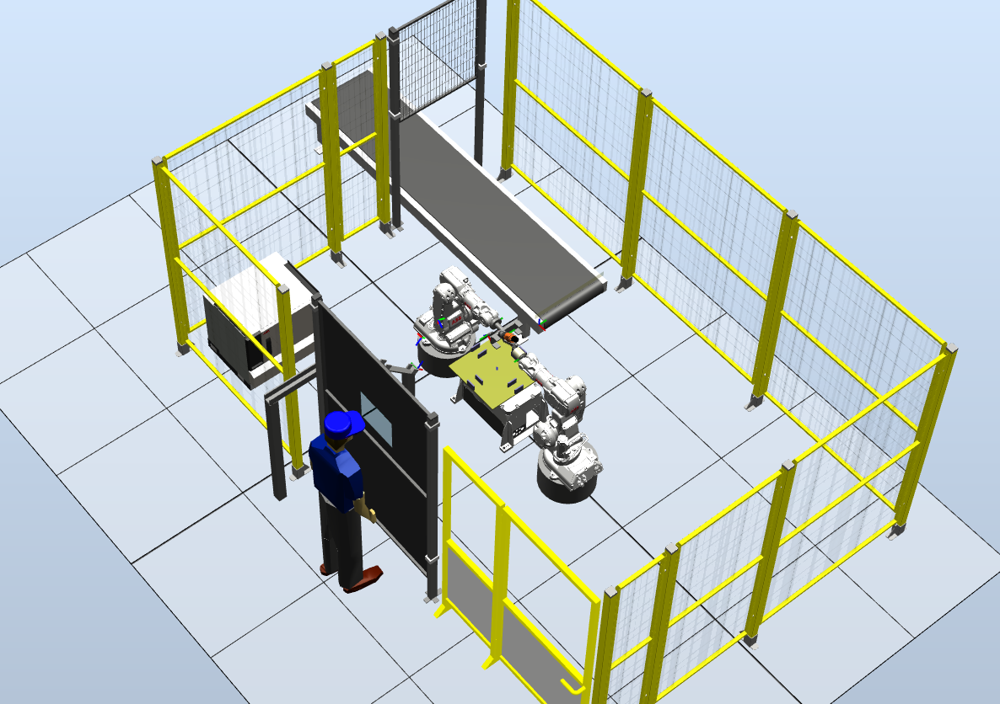
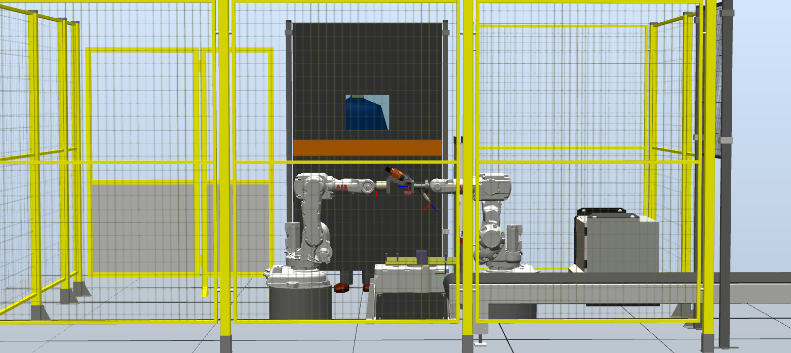
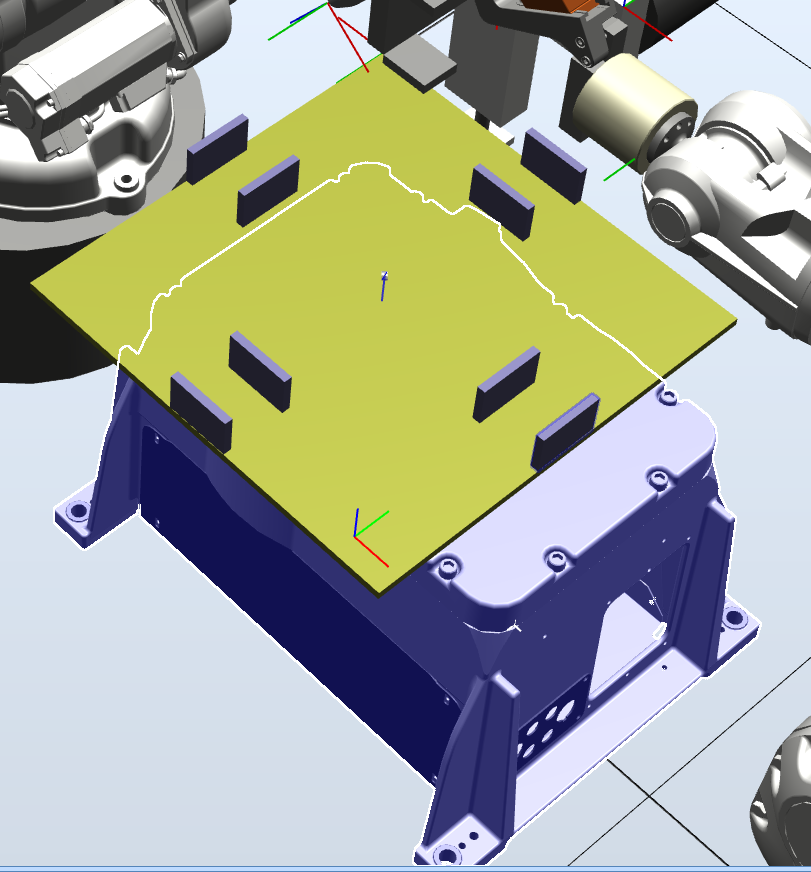
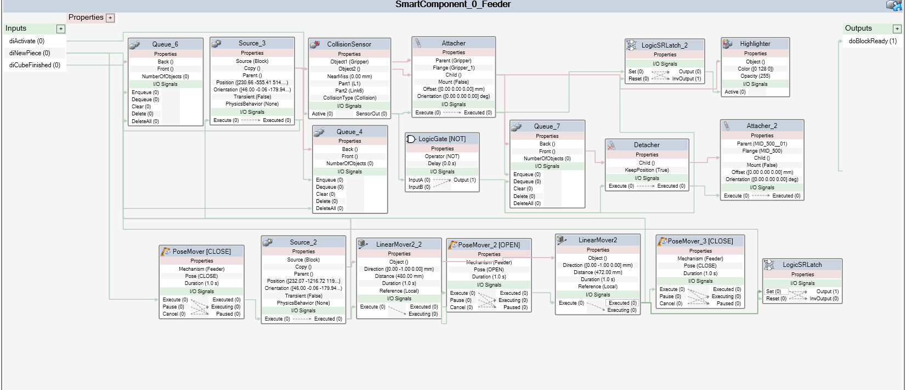
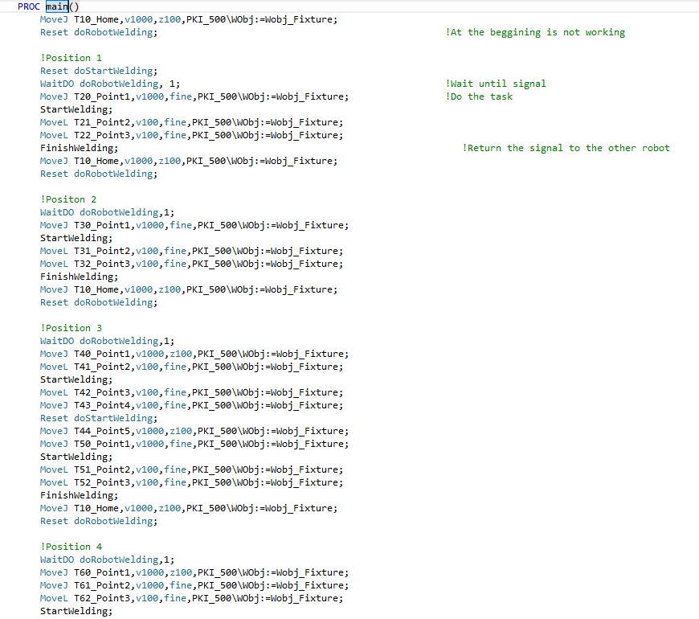

# ABB MultiMove welding cell (RobotStudio, RAPID)

Offline-programmed robotic welding cell in ABB RobotStudio. A MultiMove system runs two RAPID tasks (`TASK1`, `TASK2`) for two robots around a feeder, a fixture and a gripper. Welding is simulated with digital signals (`doRobotWelding`, `doRobotAttacher`, `doStartWelding`); nothing is welded or measured.

Course PR310G Industrial Robotics & Offline Programming, University of Skövde, 2021.

**Team project; I worked across the whole implementation.** Licence pending agreement with the team.

## What is in the repository

- `robotstudio/rapid/task1/Module1.mod` and `task2/Module1.mod`, plus their `CalibData.mod`. Task 1 has 64 `MoveJ/MoveL/MoveC` lines and waits on `doRobotWelding` between weld positions (`StartWelding`, `FinishWelding`). Task 2 has 99 move lines and procedures `AttachGripp`/`DetachGrip`/`HoldAndDetach`, `StartWelding` and `CreateBlock` (waits for `diBlockReady`).
- `robotstudio/libraries/`: `Feeder.rslib`, `Fixture.rslib`, `Gripper.rslib`, library files whose author field is the generic "Admin" account (the team's equipment models).
- `docs/media/`: screenshots from the project (cell views, Smart Component graphs, RAPID code).

## What is not mine

- The fences, the operator figure and other safety-equipment models seen in the screenshots are vendor / library models from RobotStudio, not models I built. Fence and operator library files were removed from this repository for that reason.
- The ABB robots, positioner and controller are ABB products.
- I do not claim the safety concept as a result: the screenshots show fences, labelled emergency and maintenance buttons, a welding screen and safety zones placed in the cell, and the safety report is not included.

## Screenshots

Cell:

Fixture and robot tool:

Feeder Smart Component graph:

RAPID code (task procedures):

More views are in `docs/media/` (Smart Component graphs for gripper and fixture, safety views).

## Stack

ABB RobotStudio, RAPID, MultiMove, Smart Components.

## Results

No cycle times, throughput or other measurements are in the files. There is no video of the cell running.

## How to run (and limits)

The RobotStudio Pack&Go station isn't included; RAPID modules and screenshots are. The station cannot be rebuilt from this repository alone. In RobotStudio, create a MultiMove system with two tasks, import the three `.rslib` libraries, and load each `Module1.mod` into its task. I have not opened the libraries or modules in RobotStudio while preparing this repository.

Code comments are partly in Spanish.
